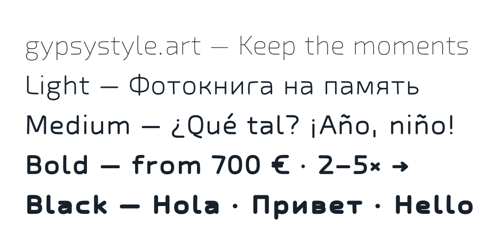

# gypsystyle.art

A monoline typeface by **Vsevolod Belikov (Gypsy Style)** — [gypsystyle.art](https://gypsystyle.art).



It started as the caption font of [Keepers](https://keepers.gypsystyle.art), a photobook app: letters drawn as single lines, like a pencil on white paper. This release expands those lines with a round pen into an installable font for desktop apps and Figma.

- **Weights:** Thin, Light, Medium, Bold, Black
- **Scripts:** Latin (English, Spanish), Cyrillic (Russian) — 198 characters, including € × → ← ↔ ↑ ↓ ° © №
- **Formats:** OTF for desktop and Figma, WOFF2 for the web
- **Version:** 1.500 (17 October 2026)

## Install

Download the latest [release](../../releases/latest), unzip, and open the `.otf` files (macOS: Font Book; Windows: right-click → Install). Restart Figma to see the family **gypsystyle.art**.

## Web

```css
@font-face {
  font-family: "gypsystyle.art";
  src: url("GypsyStyleArt-Light.woff2") format("woff2");
  font-weight: 300;
}
```

## License

SIL Open Font License 1.1 — see [OFL.txt](OFL.txt). Free to use, including in commercial work; embed, modify and redistribute under the same license. The font itself may not be sold on its own.

Single-line centerlines are derived from **Exo 2 Extra Light**, Copyright 2013 The Exo 2 Project Authors ([googlefonts/Exo-2.0](https://github.com/googlefonts/Exo-2.0)), also under the OFL. Accents, punctuation, round pen, weights and build: Copyright 2026 Vsevolod Belikov.

## Build

```sh
python -m venv .venv && .venv/bin/pip install -r requirements.txt
.venv/bin/python tools/build_otf.py
```

`sources/centerlines.json` holds each glyph as `[left, right, "SVG path"]` in source units (baseline y = 0, up is negative, cap height 20). The build:

1. **Redraws every line by vector drawing rules** (`tools/refit.py`): as few nodes as possible, nodes on extremes with horizontal or vertical handles, nodes on inflections, closed shapes without seams, near-straight lines snapped to the axis, line ends snapped onto the stems and bowls they touch.
2. **Keeps the pen inside the lines:** a round pen sticks out half its width past the centerline, so the centerline is compressed per weight and the pen edge lands exactly on baseline, x-height, cap height and descender; round shapes overshoot by 10 units.
3. **Strokes** each line with a round pen at five widths (25, 55, 75, 108, 138 per 1000) and merges overlaps.
4. **Spaces optically** (`tools/spacing.py`, Tracy / HT Letterspacer method): equal white area at each side, measured to 15 % depth and calibrated on «n» and «H» for every weight.
5. Adds € × arrows ° © № and @ (`tools/extra_glyphs.py`) and writes `fonts/otf` and `fonts/woff2`.

## Known limits

No kerning yet; Serbian Latin and Cyrillic are planned next.
